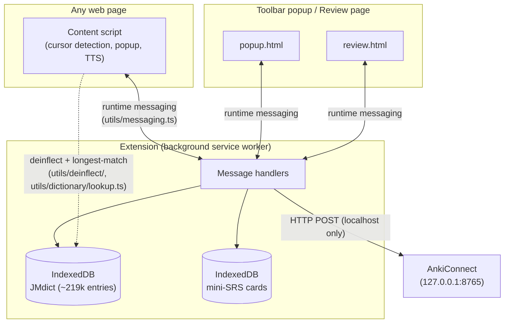

# KanjiFlow

A Manifest V3 browser extension that gives you a contextual Japanese dictionary on any web page: hold a modifier key (configurable — Shift, Alt, or always-on), hover over Japanese text, and get the dictionary-form lookup, reading, and meaning — even when the text is conjugated, deinflects correctly for verbs and i-adjectives, and ranks homographs by real-world frequency.

Everything runs locally: the dictionary lives in IndexedDB (no network calls at lookup time), and the only outbound request this extension ever makes is to AnkiConnect on `127.0.0.1` — nothing leaves the machine.

## Features

- **Contextual lookup** — Shift+hover (or Alt / always-on, your choice) over any Japanese text, on any page.
- **Deinflection engine** — a from-scratch rule table covering every godan class, ichidan, suru, the irregular kuru (both 来る and くる spellings), and i-adjectives, with chaining (causative + passive + negative resolves correctly, e.g. 食べさせられない → 食べる).
- **Longest-match segmentation** — Japanese has no spaces; this tries substrings of decreasing length from the cursor so a short accidental match never wins over a longer conjugated word that's actually there.
- **Homograph frequency ranking** — when multiple entries share a reading (e.g. 橋/箸/端, all はし), they're ranked using JMdict's own frequency tags, and each gets its own clearly-separated card.
- **Anki export or a built-in mini-SRS** — click to pin a lookup, then add it to Anki via [AnkiConnect](https://ankiweb.net/shared/info/2055492159), or to a built-in SM-2 spaced-repetition queue if you don't use Anki. A dedicated review page walks through due cards.
- **Text-to-speech** — hear the reading via the browser's built-in Web Speech API.
- **Toolbar popup** — configure the activation key, deck name, and Anki/mini-SRS mode; see AnkiConnect connectivity, dictionary size, and recently-added cards at a glance.

## Architecture



The background service worker is the only context that holds the two IndexedDB connections open — the content script, popup, and review page all go through the typed message-passing layer (`utils/messaging.ts`) rather than opening their own connections, so there's a single source of truth for both the dictionary and the review queue.

## Tech stack

- **[WXT](https://wxt.dev)** (Vite-based MV3 framework) + TypeScript, no UI framework (vanilla DOM)
- **IndexedDB** via [`idb`](https://github.com/jakearchibald/idb) for both the dictionary and the mini-SRS
- **[JMdict](https://www.edrdg.org/jmdict/j_jmdict.html)** as the dictionary source, parsed by a custom XML→JSON pipeline (`scripts/jmdict/`)
- **Vitest** + `fake-indexeddb` + `jsdom` for the test suite
- **AnkiConnect** for Anki export; the **Web Speech API** for pronunciation — both used directly, no extra dependency

## Development

```bash
npm install
npm run build:dictionary   # downloads nothing itself - see below for the one manual step
npm run dev                # opens Chrome with the extension loaded
```

`npm run build:dictionary` regenerates the bundled dictionary from JMdict's XML. It needs the raw source first:

```bash
mkdir -p data/raw
curl -o data/raw/JMdict_e.gz http://ftp.edrdg.org/pub/Nihongo/JMdict_e.gz
gunzip data/raw/JMdict_e.gz
npm run build:dictionary
```

Other useful commands:

```bash
npm run compile    # type-check
npm run test       # run the Vitest suite (fast - uses a tiny fixture dictionary, not the real one)
npm run build      # production build -> .output/chrome-mv3/
```

See [`CLAUDE.md`](./CLAUDE.md) for a deeper tour of the codebase's structure and the reasoning behind specific design decisions.

## Dictionary data attribution

This software uses the JMdict dictionary file. This file is the property of the [Electronic Dictionary Research and Development Group](https://www.edrdg.org/), and is used in conformance with the Group's [licence](https://www.edrdg.org/edrdg/licence.html).

## License

No license has been chosen yet for this project's own code — MIT would be a reasonable default for a project like this, but that's a decision for you to make (and a `LICENSE` file to add) before treating it as open source. The JMdict data's own licence is as described above regardless.
